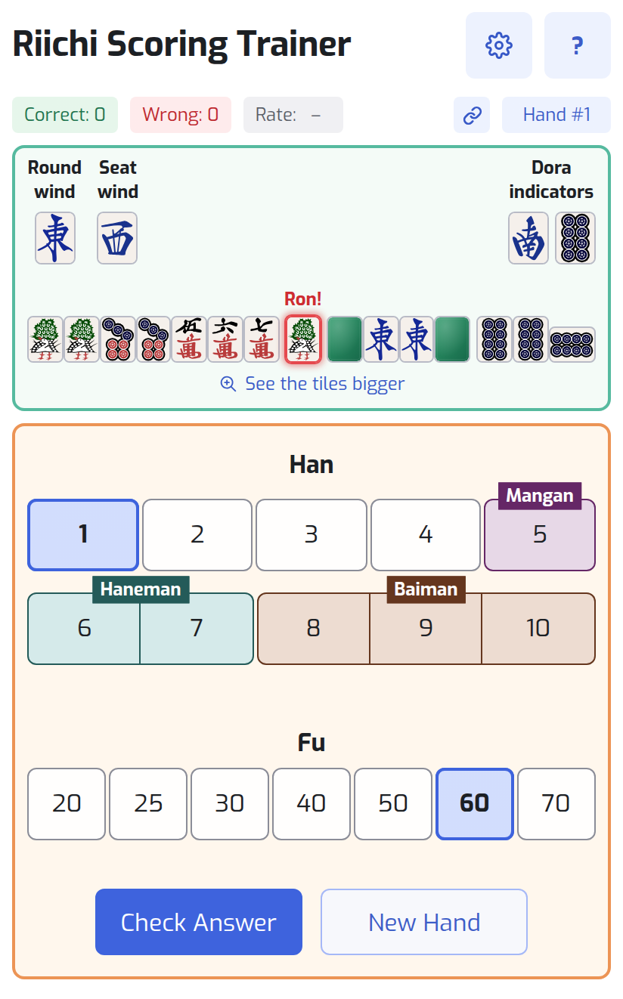
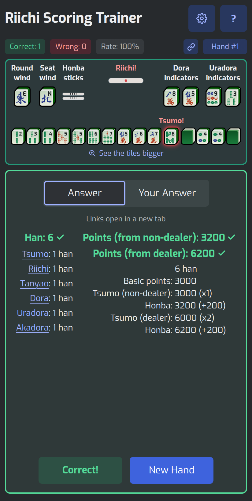

# Riichi Scoring Trainer

A web app for practicing scoring in riichi mahjong. It deals you a winning hand, and you work out the han, the fu, and the points.

It lives at https://riichi.youngren.io/.

<table>
  <tr>
    <th valign="middle">Light mode, before checking the answer</th>
    <th valign="middle">Dark mode, with more options turned on,<br />showing the answer</th>
  </tr>
  <tr>
    <td align="center" valign="top"></td>
    <td align="center" valign="top"></td>
  </tr>
</table>

# FAQ

## Where did this come from?

This is a fork of [Varantha/Mahjong-ScoringTrainer](https://github.com/Varantha/Mahjong-ScoringTrainer). The hands and the scoring logic are Varantha's work and the work of the people who contributed there.

## Why a fork?

The quiz and the scoring are the same. Most of what I changed is around them:

- A new look, with light and dark themes, a high contrast option, and a second set of tiles.
- It's laid out for a phone first. You can tap the tiles to see them bigger, and put names on them if you can't read them yet.
- When you check an answer, each of your picks is marked right or wrong, and the answer shows up where the questions were, with a tab to flip back to what you picked. In English, the yaku and fu lines link to the wiki.
- A "Just tell me" feature.
- Every hand gets its own url.
- The scoring pages were completely redone in the style of another resource.
- It works offline.
- It's built to work with a keyboard and a screen reader and is tested with axe.

## Where do the hands come from?

All 1,963 hands, with some minor fixes, are taken directly from the [original repository](https://github.com/Varantha/Mahjong-ScoringTrainer), which themselves came from Tenhou logs. If one looks wrong, use "Report a problem with this hand" in the options.

## What languages does it support?

English, Japanese (日本語), Korean (한국어), and Chinese (Simplified) (中文简体).

All of the non-english text is computer generated. If you'd like to provide translation support, please reach out, or check out the [Translation Guide](TRANSLATION_GUIDE.md).

# Running it locally

You'll need the version of Node in `.nvmrc`.

1. Clone the repo
   ```sh
   git clone git@github.com:zack/riichi.git
   cd riichi
   ```
1. Install the dependencies
   ```sh
   npm install
   ```
1. Start the dev server. It prints the address to open, usually http://localhost:5173
   ```sh
   npm run dev
   ```
1. Or make a production build, which lands in `dist/`, and serve it
   ```sh
   npm run build
   npm run preview
   ```

The service worker that makes it work offline only runs in a production build.

To open one particular hand, copy its link in the app, or put its name on the end of the address yourself: `?hand=2011010101gm-00a9-0000-370cfc0a2`. The names are the file names in `src/data`, without the `.json`.

# Testing

There are Cypress tests for the quiz and the scoring, for accessibility, and for how it looks. They run in Chrome against the production build on port 5173. On GitHub, everything but the accessibility tests and the tests for how it looks runs in Firefox as well.

1. Build and serve the app
   ```sh
   npm run build
   npm run preview -- --port 5173
   ```
1. Run the tests
   ```sh
   npm run cypress:cli
   ```

The visual tests compare screenshots against the ones in `cypress/snapshots/base`. If you changed how something looks on purpose, take new ones and commit them.

```sh
npm run cypress:update-snapshots
```

Four more checks run on every pull request, along with the tests. The first two also run on the files you commit.

```sh
npm run lint
npm run format:check
npm run check:compiler
npm run check:hands
```

`check:compiler` makes sure the React Compiler compiled every component and hook. The app has no `useMemo`, and the build doesn't say when the compiler skips one.

`check:hands` makes sure every hand's han and fu is one of the choices the quiz offers.

# Special Thanks

- [Varantha](https://github.com/Varantha) for the original trainer and the log parser.
- [escheraz](https://github.com/escheraz) for the exact fu option.
- [Cangjie6](https://commons.wikimedia.org/wiki/User:Cangjie6) for the fancy tiles, which are on Wikimedia Commons under CC BY-SA 4.0. The details are in [their folder](public/assets/tiles/fancy/README.md).
- The people the original thanks: [Euophrys](https://github.com/Euophrys), [ApplySci](https://github.com/ApplySci), [MahjongRepository](https://github.com/MahjongRepository), [NegativeMjark](https://github.com/NegativeMjark), [FluffyStuff](https://github.com/FluffyStuff), [Elthron](https://github.com/Elthron), and [fathoms](https://github.com/fathoms).

[](LICENSE)
